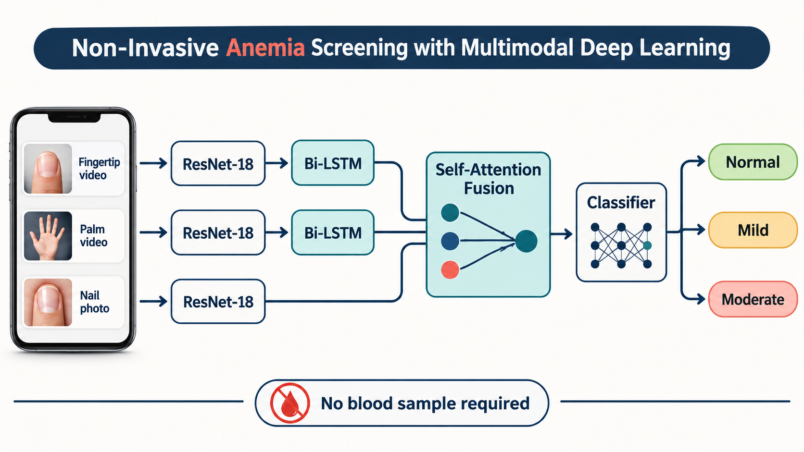
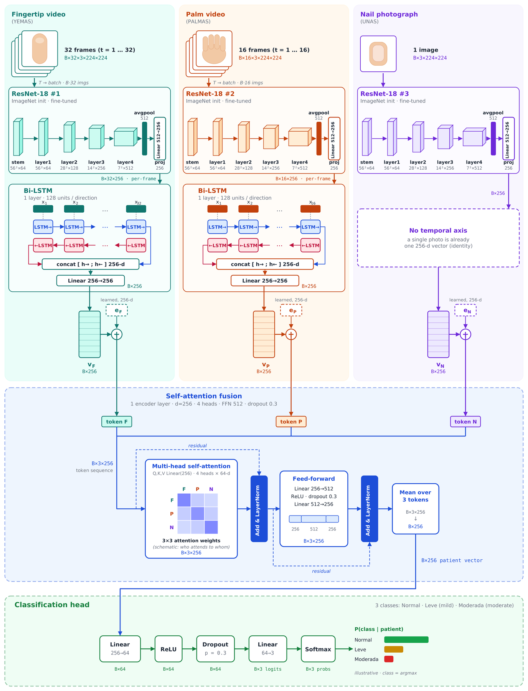

# Beyond the Needle: Attention-Based Multimodal Deep Learning for Anemia Screening


Final Year Design Project (B.Sc. CSE), United International University, Department of Computer Science and Engineering.

**Team:**
- Jasmin Sultana Shimu
- Sayma Sultana
- Md Fazley Rabbi
- Tasmim Jahan Rimvy

**Supervisor:** Dr. Jannatun Noor Mukta  
**Co-Supervisor:** Khushnur Binte Jahangir

---

## About

Imagine a village clinic with no laboratory, or a patient who simply can't get a blood test. Anemia affects a large part of the world's population, yet diagnosing it normally means drawing blood and sending it to a lab.

We asked a simple question: what if a phone camera could give a first signal instead? Our skin and nails change subtly with anemia, so we trained deep learning models on short smartphone recordings of the fingertip, the palm and a single fingernail photo from 909 young adults.

First, we taught a model to read each recording on its own. Then we tested how to combine the three: how to follow motion across video frames, how to let the model decide which recording to trust more (self-attention), and whether age and symptoms help. Finally, we put our best model up against eleven published methods on the same task.

The answer is hopeful but honest. All three recordings carry a real anemia signal, and our model held its ground against every benchmark. But it caught only one of seven moderate cases, so it is not yet ready to replace a blood test. This repository holds the full story: the data, experiments, final model and thesis.

---

## 1. Summary

| | |
|---|---|
| **Problem** | Anemia is usually diagnosed with a blood test, which is often unavailable in remote or low-resource settings. |
| **Goal** | Test whether smartphone recordings of the **fingertip video, palm video and nail photo** can support non-invasive anemia screening, and how to best combine them. |
| **Dataset** | AnaeCare public dataset, 909 young adults (Valles-Coral et al., 2025). Three classes: Normal / Leve (mild) / Moderada (moderate). |
| **Approach** | ImageNet-pretrained ResNet-18 per modality → temporal pooling (mean or Bi-LSTM) → fusion (concatenation or self-attention) → classifier. |
| **Evaluation** | Patient-level stratified splits, fixed 123-subject test set, 5-fold CV, macro-F1 / AUC. |

## 2. Challenges

- Severe class imbalance (Moderada: only 7 test subjects).
- Small, single-site dataset.
- Predicting "Normal" for everyone already gives 0.707 accuracy, so accuracy alone is misleading; macro-F1 is used instead.
- One configuration scored suspiciously high (different input folders) and was excluded as unreliable.
- An inconsistency was found in the label file used for the binary experiments.

## 3. Pipeline

1. **Preprocessing:** frame extraction (fingertip 32, palm 16, nail 1), resized to 224×224.
2. **Single-modality models:** ResNet-18 fine-tuned per modality. Frame-count and training-strategy ablation (class weighting, augmentation).
3. **Fusion ablation:** concatenation vs self-attention, mean pooling vs Bi-LSTM, with or without demographics, under single-split and 5-fold protocols.
4. **Model selection:** best among fairly comparable runs.
5. **Benchmarking:** 11 re-implemented published methods on the same 3-class task.

## 4. Final Model

Image-only · Bi-LSTM temporal pooling · self-attention fusion · 3-class · 5-fold CV.



## 5. Key Results

| Stage | Result |
|---|---|
| Best single modality (accuracy) | Fingertip 73.87% · Nail 67.27% · Palm 67.20% |
| Final model, 5-fold macro-F1 | **0.459 ± 0.075** |
| Final model, macro-AUC (fold-averaged) | 0.756 |
| Demographics-only logistic regression | 0.407 macro-F1 |
| Benchmark | Not exceeded on macro-F1 by any of 11 methods; 7 were within one SD |

**Takeaway:** the three recordings carry a detectable anemia signal, but no fusion component gave a statistically supported gain, and the model found only 1 of 7 moderate cases. Performance is **not yet adequate for stand-alone clinical screening**.

## 6. Repository Structure

```
├── data/                  Preprocessing notebooks and scripts
├── ablation_studies/      ex0 binary · ex1 image-only · ex2/ex3 with demographics
├── final_model/           Notebook, results, architecture diagrams, best_model_report.md
├── benchmarking/          Re-implementations of published methods (per team member)
├── documentation/         Dataset info, preprocessing report, ablation docs, slides
├── literature review papers/   Reference PDFs
└── report/                Thesis (LaTeX source, final PDF, benchmark chapter, similarity report)
```

## 7. Quick Links

- 📄 Thesis PDF: `report/pdf/`
- 🏆 Final model report: `final_model/best_model_report.md`
- 🧪 Ablation summary: `documentation/ablation studies files/ablation_studies.md`
- 🧹 Preprocessing report: `documentation/DATASET info/preprocessing_report.md`
- 📊 Benchmark table: `report/benchmark doc and figures/Bench-mark-files-section/benchmark_comparison_data.csv`

## 8. Limitations

Single-site data, small test set, large fold-to-fold variance, early overfitting, and no clinical validation.

## 9. Reproducibility

Experiments ran on Kaggle (2 × Tesla T4) and Google Colab (preprocessing), Python / PyTorch, seed 42. The dataset is public; download it from the original paper listed in `documentation/DATASET info/`.
